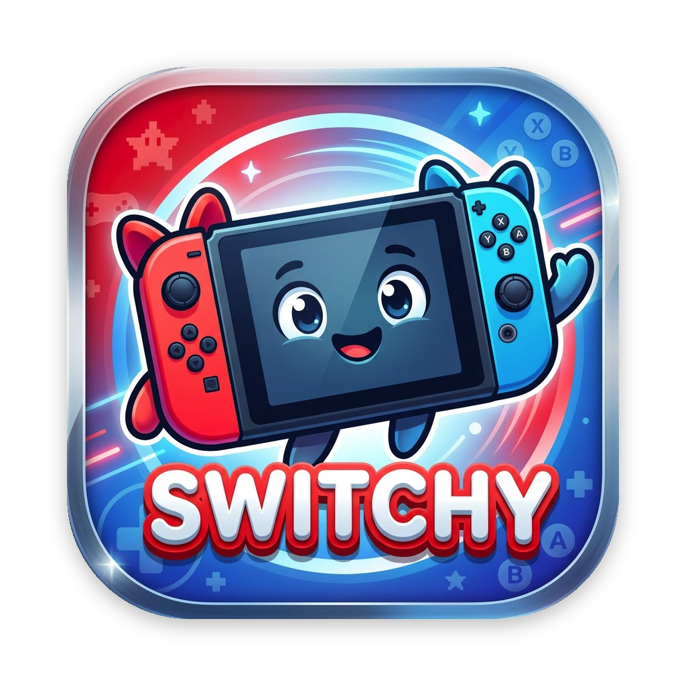
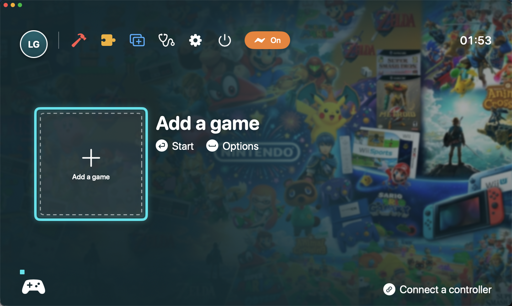
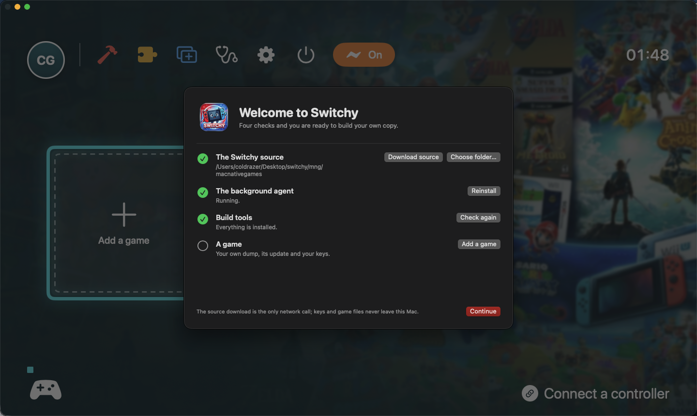
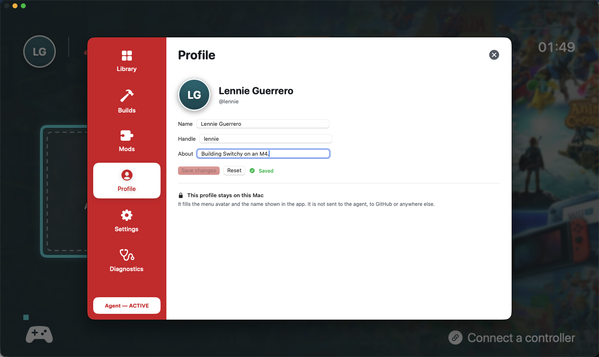
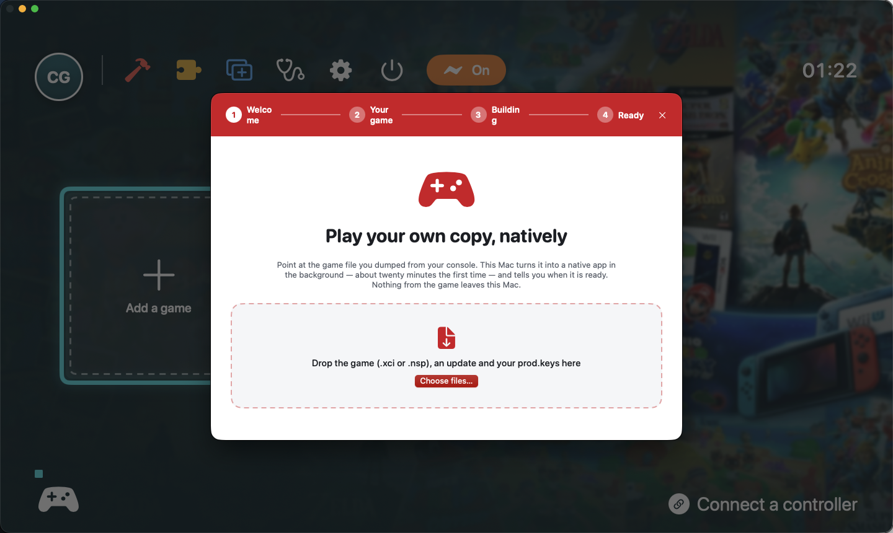
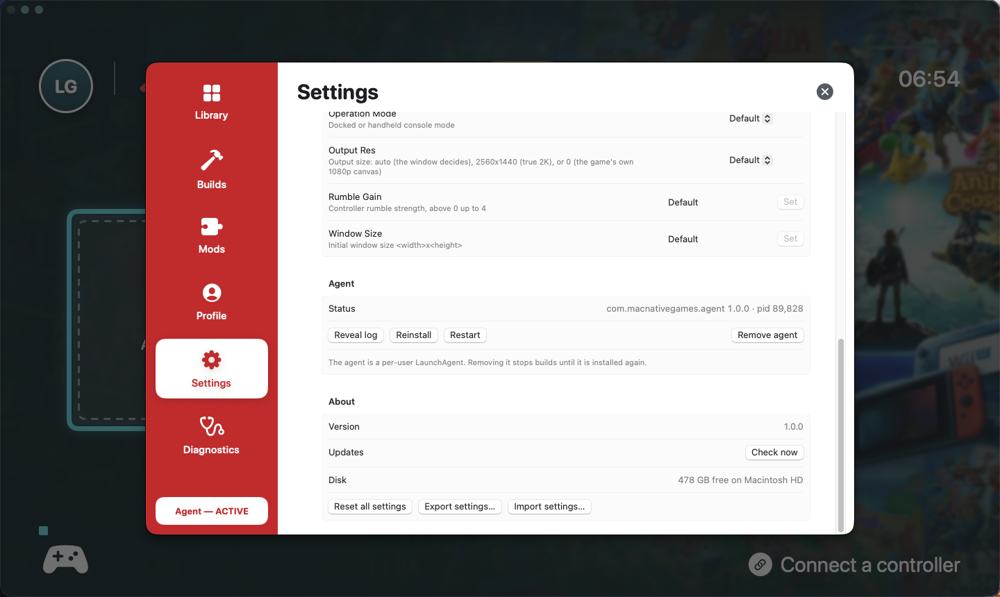
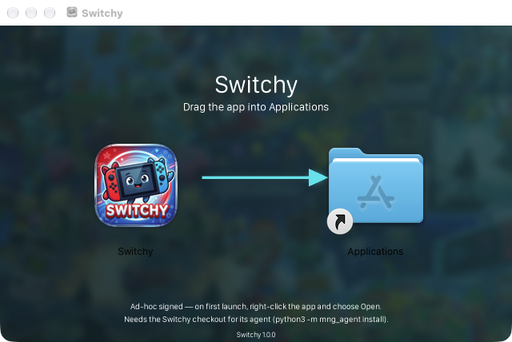

<p align="center">
  
</p>

<h1 align="center">Switchy</h1>

<p align="center"><b>Your own Tears of the Kingdom, as a native Apple-silicon Mac app.</b></p>

<p align="center">
  <a href="https://github.com/coldrazer/Switchy/releases/latest"></a>
  
  
  <a href="LICENSE"></a>
  <a href="https://github.com/coldrazer/Switchy/actions/workflows/tests.yml"></a>
</p>



Switchy turns a game you already own into a real Mac application, then stays out of the way: a console-style menu
for your library, a Setup Assistant that builds in the background, and a small agent that keeps working when the
window is closed.

It is not an emulator. The game's own ARM64 machine code runs on the Apple chip; Switchy supplies what the Switch
would — a loader, Horizon services, and a Metal 4 renderer — and wraps the result in a `.app` you can launch like any
other. See [how it works](docs/how-it-works.md).

> **Bring your own game.** This repository ships no game code, keys, firmware or saves. You need your own dump of
> *The Legend of Zelda: Tears of the Kingdom* (base 1.0.0, optionally updated to 1.1.2 / 1.2.1 / 1.4.3) and your own
> `prod.keys`.

## Highlights

- **Console-style library** — games appear as tiles over their own extracted art, navigable with arrow keys or a
  controller; Return plays, Space opens the game card.
- **Setup Assistant** — drop an XCI/NSP, an update and `prod.keys`; Switchy identifies them by content, builds in the
  background and offers **Play now** when the app is ready.
- **A real agent** — builds are owned by a per-user LaunchAgent, so quitting the app never stops a build, and an
  interrupted build resumes on the next start.
- **Mods** — keep mods in a library, enable them per game version; conflicting files are refused before the game sees
  them.
- **Settings and diagnostics** — game settings are validated and passed as `TOTK_*` variables; one click exports a
  diagnostics archive with keys redacted.
- **Shader prewarming** — startup shaders are prepared and compiled at build time, so the first launch does not
  stutter through them.
- **Your profile** — click the avatar for a local identity: name, handle and a line about you. It fills the menu
  avatar and stays on this Mac.
- **Guided first run** — a checklist that checks the source, agent and tools, and can download the source for you.
- **Settings that work** — validated paths, reset, import/export, and the agent's own controls: reveal log, reinstall,
  restart, remove, update check and free disk space.
- **Quiet when it should be** — a notification when a build finishes behind another window; search in the library;
  drag a folder onto Mods to install it.

| Welcome | Profile |
|:---:|:---:|
|  |  |
| **Setup Assistant** | **Settings** |
|  |  |

## Install

1. Download the latest **`Switchy-1.0.0.dmg`** from [Releases](https://github.com/coldrazer/Switchy/releases/latest).
2. Open it and drag **Switchy** into **Applications**.
3. The build is ad-hoc signed, not notarized. On first launch, right-click the app and choose **Open** (or run
   `xattr -dr com.apple.quarantine /Applications/Switchy.app`).

<p align="center"></p>

> The DMG contains the app. The agent and the build pipeline live in this repository: run
> `python3 -m mng_agent install` from your checkout, or let the app install it — it asks for the checkout folder the
> first time it needs it. Building a game also needs Xcode Command Line Tools, Homebrew and Python 3.14.

## Build from source

Requires Apple silicon, macOS 26 or later, Xcode Command Line Tools, [Homebrew](https://brew.sh) and 25 GB of free
disk for the work folder.

```sh
brew install opus libvpx python@3.14
git clone https://github.com/coldrazer/Switchy.git
cd Switchy

python3 -m mng_agent install          # LaunchAgent: the agent starts now and at every login
cd apps/Switchy && ./make_app.sh      # -> build/Switchy.app
./make_dmg.sh                         # optional: -> build/Switchy-1.0.0.dmg
```

`make_app.sh` uses Xcode when it is installed and selected; it falls back to `/Applications/Xcode.app` when the
active developer directory is only the Command Line Tools, whose SwiftUI module has no `@State` macro plugin.

### Build a game

```sh
python3.14 build_app.py ~/Games/totk.xci -k ~/keys/prod.keys
python3.14 build_app.py ~/Games/totk.xci -k ~/keys/prod.keys --update ~/Games/1.4.3.nsp
```

The same pipeline is available from the app, or from the command line through the agent:

```sh
python3 -m mng_agent build ~/Games/totk.xci --update ~/Games/1.4.3.nsp --wait
python3 -m mng_agent status | jobs | log <id> -f | cancel <id>
```

Full options — NSP input, firmware fonts, output paths, iOS builds — are in the
[game build guide](docs/game-build-guide.md).

## How it works

```
Switchy.app  (apps/Switchy, SwiftUI)              game menu · Setup · Library · Builds · Mods · Settings · Diagnostics
      │  Unix socket, newline-delimited JSON       mng_agent/protocol.py
com.macnativegames.agent  (mng_agent, Python)      job queue · state store · detection · mods · watcher
      │  supervised subprocess                     mng_agent/runner.py
build_app.py                                       the build as a step graph
      │
native runtime  (games/totk)                       loader · Horizon services · NVN on Metal 4 · audio · input
```

The app is a client; the agent owns the state. A build keeps going when the app quits because the agent is a
LaunchAgent, not a child process. The runtime is native ARM64: the game's own code runs on the Apple chip, and only
the platform edges — system calls, the platform register, thread pointer, counters — are rewritten ahead of time.

## Project layout

| Path | What it is |
|---|---|
| `apps/Switchy` | The SwiftUI app (`MNGCore` models + socket client, `Switchy` UI) and its build scripts |
| `mng_agent` | The Python agent: job queue, state store, detection, mods, watcher |
| `build_app.py` | The command-line build pipeline shared by the app and the agent |
| `games/totk` | The native runtime: loader, Horizon services, NVN-on-Metal renderer, audio, input |
| `vendor/ryujinx` | Pinned Ryujinx shader translator and audio code used by the runtime |
| `tests` | Python and C tests for the build pipeline, parsers and runtime |

## Documentation

- [Switchy.app and its agent](docs/app.md)
- [How the runtime works](docs/how-it-works.md)
- [Game build guide](docs/game-build-guide.md)
- [First-launch shaders](docs/first-launch-shaders.md)
- [Shader list and contributions](docs/shader-list.md)
- [Audio troubleshooting](docs/audio-troubleshooting.md)

## Status

**1.0.0** is the first build: the console menu, Setup Assistant, library, builds, mods, settings and diagnostics,
plus the profile, the guided first run, validated settings with agent controls, background-build notifications,
library search, drag-and-drop mods, rotated agent logs and a CI job that builds the app on every push. Still to come:
notarized releases (the script is in `apps/Switchy/notarize.sh` but needs a Developer ID), a self-contained agent, and
streaming RomFS. The DMG is ad-hoc signed — expect Gatekeeper to ask on first launch.

## Legal

Switchy contains no game code, no keys, no firmware and no saves, and is not affiliated with Nintendo. You must
supply your own legally obtained copy of the game and your own keys. *Nintendo Switch* and *The Legend of Zelda:
Tears of the Kingdom* are trademarks of Nintendo; this project is an independent interoperability effort.

Third-party components and their licenses are listed in [THIRD_PARTY_NOTICES.md](THIRD_PARTY_NOTICES.md). This
repository's own code is MIT licensed.

## Acknowledgements

The runtime stands on work from [Ryujinx](https://github.com/Ryujinx/Ryujinx) (shader translation, audio),
[d2r-mobile](https://github.com/jhaizhou-ops/d2r-mobile) (NSO rewriting, NVN on Metal), SPIRV-Cross, hactool, bcdec,
deko3d, libopus and libvpx.

## License

[MIT](LICENSE) © 2026 Switchy contributors
